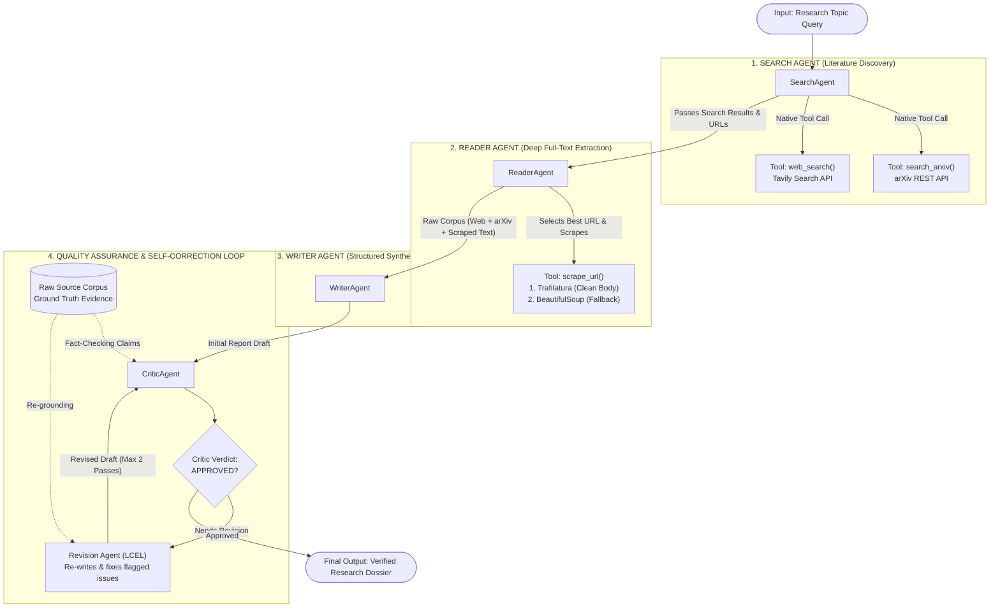

# Coeus 🪐 — Autonomous Scientific Multi-Agent Research Assistant

> **Coeus** is an autonomous, publication-grade scientific research engine. Instead of relying on a single prompt, Coeus deploys a collaborative swarm of specialized cognitive agents to discover, extract, synthesize, and rigorously fact-check complex scientific and technical topics with zero hallucinations.

---

## 🌟 Key Highlights

- **Multi-Agent Separation of Concerns**: Deconstructs research workflows across specialized agents (Discovery, Extraction, Synthesis, and Verification).
- **Adversarial QA & Self-Correction Loop**: An independent Critic Agent verifies every generated assertion against raw evidence, triggering automated re-drafting (`MAX_REVISIONS = 2`) until approved.
- **Dual Academic & Real-Time Web Discovery**: Combines peer-reviewed preprints from the **official arXiv REST API** with real-time web intelligence via **Tavily**.
- **Resilient Failover Web Scraping**: Primary extraction uses `trafilatura` to isolate clean main body text; seamlessly fails over to `requests` + `BeautifulSoup` if blocked.
- **Native Tool Calling**: Replaced legacy text-parsed ReAct loops with typed JSON function calling on Gemini 2.0 Flash Lite.
- **Cinematic & Lightweight Frontend**: React 19 UI inspired by Claude with an interactive 3D Canvas Galaxy Intro (1,850 particles) that unmounts after load for zero idle CPU/GPU consumption.

---

## 🏗️ System Architecture



---

## 🤖 The Multi-Agent Swarm

| Agent | Architecture | Primary Tools / Inputs | Deliverable |
|---|---|---|---|
| **1. Search Agent** | `create_agent()` (Native Function Calling) | `web_search()` (Tavily), `search_arxiv()` (arXiv) | Curated list of URLs, paper titles, and abstracts. |
| **2. Reader Agent** | `create_agent()` (Native Function Calling) | `scrape_url()` (Trafilatura + BeautifulSoup) | Clean full-text methodology and empirical data up to 4,000 characters. |
| **3. Writer Agent** | LCEL (`writer_prompt \| llm \| parser`) | Combined research corpus | Initial 6-part structured research paper. |
| **4. Critic Agent** | LCEL (`critic_prompt \| llm \| parser`) | Draft report + Raw evidence | Adversarial review with `APPROVED` or `NEEDS REVISION` verdict. |
| **5. Revision Agent** | LCEL (`revision_prompt \| llm \| parser`) | Draft + Critique + Raw evidence | Factually strengthened, publication-ready research dossier. |

---

## 🛠️ Tech Stack

- **Frontend**: React 19, Vite 8, Tailwind CSS 4, HTML5 2D Canvas (Euler 3D Projection).
- **Backend API**: Python 3.11+, FastAPI, Uvicorn (ASGI), Pydantic v2.
- **Agent Orchestration**: LangChain Core, LangChain Expression Language (LCEL).
- **Language Model**: Google Gemini 3.5 Flash Lite (`temperature=0.2`).
- **Information Retrieval**: Tavily Search API, arXiv REST API (Atom XML), Trafilatura, BeautifulSoup4.
- **Persistence**: Client-side `localStorage` + Server JSON Store (`history.json`).

---

## 📁 Repository Structure

```text
├── backend/
│   ├── .env                    # API keys (GOOGLE_API_KEY, TAVILY_API_KEY)
│   ├── agents.py               # Agent definitions (Search, Reader, Writer, Critic, Revision)
│   ├── app.py                  # Standalone Streamlit Dashboard UI
│   ├── pipeline.py             # Multi-agent coordination and self-correction loop
│   ├── server.py               # FastAPI REST Gateway with CORS
│   └── tools.py                # Tool integrations (Tavily, arXiv, Trafilatura/BS4)
├── frontend/
│   ├── public/                 # Static assets (favicons, SVG icons)
│   ├── src/
│   │   ├── pages/
│   │   │   └── Frontpage.jsx   # Primary React UI & 3D Galaxy Engine
│   │   ├── App.jsx             # Main router
│   │   ├── index.css           # Tailwind styling & animations
│   │   └── main.jsx            # React root mount
│   ├── package.json            # Frontend dependencies
│   └── vite.config.js          # Vite build configuration
└── README.md
```

---

## 🚀 Getting Started

### Prerequisites

- **Python**: `3.11` or higher
- **Node.js**: `18.0` or higher
- **API Keys**:
  - [Google AI Studio](https://aistudio.google.com/) (`GOOGLE_API_KEY`)
  - [Tavily AI](https://tavily.com/) (`TAVILY_API_KEY`)

---

### Step 1: Environment Setup

Clone the repository and set up your backend environment variables:

```bash
git clone https://github.com/your-username/coeus.git
cd coeus
```

Create a `.env` file inside the `backend/` directory:

```env
GOOGLE_API_KEY=your_gemini_api_key_here
TAVILY_API_KEY=your_tavily_api_key_here
```

---

### Step 2: Start the Backend (FastAPI)

```bash
cd backend
python -m venv .venv

# On Windows:
.venv\Scripts\activate
# On macOS/Linux:
# source .venv/bin/activate

pip install -r requirements.txt  # Or install: fastapi uvicorn langchain langchain-google-genai tavily-python beautifulsoup4 requests trafilatura
python server.py
```
> The API will be live at `http://localhost:8000`. Interactive Swagger docs are available at `http://localhost:8000/docs`.

---

### Step 3: Start the Frontend (Vite)

In a **second terminal**:

```bash
cd frontend
npm install
npm run dev
```
> The web interface will be available at `http://localhost:5173`.

---

### Alternative: Run via Streamlit Dashboard

If you prefer testing through Streamlit's interface:

```bash
cd backend
streamlit run app.py
```

---

## 📡 API Reference

### 1. Health Check
`GET /api/health`
```json
{
  "status": "ok",
  "service": "Coeus Multi-Agent Engine",
  "engine": "FastAPI + Gemini 2.0 Flash Lite"
}
```

### 2. Execute Research Investigation
`POST /api/research`
```json
// Request Body
{
  "topic": "Quantum error mitigation benchmarks"
}

// Response Body
{
  "id": "rec-1731002345",
  "title": "Quantum error mitigation benchmarks",
  "date": "Today",
  "report": "# Research Report: Quantum error mitigation...\n\n## Executive Summary...",
  "sources": [
    { "title": "Scalable Error Mitigation Protocols", "source": "arXiv:2402.11928", "year": "2024" }
  ],
  "feedback": "FINAL VERDICT: APPROVED"
}
```

### 3. Fetch History
`GET /api/history`
Returns an array of previously evaluated research dossiers.

---

